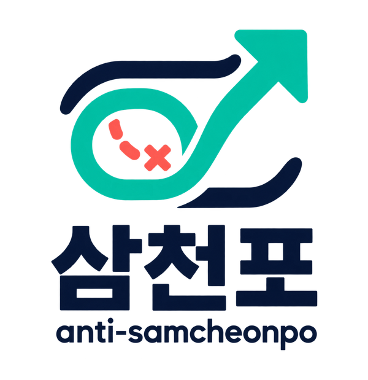

<div align="center">
<picture>
  <source media="(prefers-color-scheme: dark)" srcset="docs/assets/logo-dark.png">
  
</picture>

**AI 코딩 에이전트의 반복 작업과 실패를 기록하고, 필요하면 경고하거나 실행을 막는 로컬 도구**

[CI](https://github.com/JinHo-von-Choi/anti-samcheonpo/actions/workflows/ci.yml) · [다운로드](https://github.com/JinHo-von-Choi/anti-samcheonpo/releases/latest) · [English](README.en.md)
</div>

## 무엇에 쓰나요?

Claude Code나 Codex에 연결해 **같은 검사 반복, 같은 오류 재시도, 요청 범위를 벗어난 수정** 같은 행동을 살펴봅니다. 명령·파일 변경·실행 결과를 근거로 에이전트에게 다음 행동을 안내하고, 일부 반복 행동은 실행 전에 막습니다. 지난 세션의 사용량과 판정 근거도 조회할 수 있습니다.

## 설치

[릴리즈](https://github.com/JinHo-von-Choi/anti-samcheonpo/releases/latest)에서 운영체제·CPU에 맞는 압축 파일과 `SHA256SUMS`를 받으세요. Linux·macOS·Windows의 amd64/arm64 파일을 제공합니다.

Linux x86-64 예시:

```sh
sha256sum --ignore-missing -c SHA256SUMS
tar -xzf samcheonpo_0.11.0_linux_amd64.tar.gz
mkdir -p ~/.local/bin
cp samcheonpo samcheonpo-hook ~/.local/bin/
export PATH="$HOME/.local/bin:$PATH"
samcheonpo --version
```

두 실행 파일은 **같은 폴더**에 둡니다. PATH는 사용 중인 셸 설정에도 추가하세요. [macOS·Windows·소스 설치와 업그레이드](docs/getting-started.md#설치와-업그레이드)

## 바로 사용하기

**1. 지난 기록을 분석합니다.** 에이전트 연결 없이 실행할 수 있습니다. 모델을 호출하지 않으며 분석 결과는 로컬 원장에 저장합니다.

```sh
samcheonpo audit --agent codex --since 7d
samcheonpo sessions
```

**2. 쓰는 에이전트에 연결합니다.** 아래 둘 중 필요한 명령만 실행하세요.

```sh
samcheonpo install --agent codex
# Claude Code를 쓴다면: samcheonpo install --agent claude
samcheonpo doctor --agent codex
```

에이전트에서 **새 세션을 시작**하세요. 훅·플러그인 신뢰 확인이 나오면 설치한 삼천포 항목을 확인해 승인합니다. 첫 훅이 호출되면 감시 프로세스가 자동으로 시작됩니다.

Antigravity CLI(`agy`), MiniMax Code, GitHub Copilot 등도 연결할 수 있습니다. [에이전트별 연결 방법](docs/getting-started.md#에이전트-연결-확인)과 [지원 기능](docs/support-matrix.md)을 참고하세요. Python SDK 연동은 [Deep Agents 연결 안내](plugins/deepagents/README.md)에 있습니다.

**3. 평소처럼 작업하고, 경고가 나오면 판단합니다.** 아래 명령은 작업 중인 프로젝트의 사용자 터미널에서 실행합니다.

| 상황 | 명령 |
| --- | --- |
| 현재 상태를 보고 싶음 | `samcheonpo cmd summary` |
| 판정이 틀렸음 | `samcheonpo cmd keep normal` |
| 이번 한 번은 진행해야 함 | `samcheonpo cmd keep now` |
| 안내한 다음 행동을 에이전트에게 전달 | `samcheonpo cmd steer` |

Claude Code에서는 `/samcheonpo:summary`, `/samcheonpo:keep normal` 같은 슬래시 명령도 사용할 수 있습니다. Codex는 위 터미널 명령을 사용합니다.

## 언제 작업을 막나요?

기본 설정은 **먼저 경고하고, 일부 규칙에서 같은 목표·대상의 반복이 확인되면 차단**합니다. 반복 경고에 의한 차단은 세션당 최대 3회입니다. 기록만 하는 규칙도 있습니다. 사용자가 수락한 보호 경로·예산은 별도 조건으로 집행합니다.

처음에는 경고 없이 기록만 보고 싶다면 `~/.samcheonpo/config.yml`의 기존 설정에 다음을 합친 뒤 새 세션을 시작하세요.

```yaml
rollout:
  mode: shadow
```

`shadow`는 일반 경고와 종료 검사를 기록만 남기도록 바꿉니다. 수락한 보호 경로·예산과 오류 은폐·테스트 약화 등 핵심 사전 차단은 계속 적용됩니다. [상세 동작](docs/reference.md#귀띔에서-차단까지)

연결을 해제하려면 다음을 실행하고 에이전트를 새로 시작하세요.

```sh
samcheonpo uninstall --agent codex
```

## 작업 기록 보기

```sh
samcheonpo receipt <세션ID>
samcheonpo evidence --session <세션ID>
samcheonpo interventions --session <세션ID> --json
```

영수증에서 사용량을, `evidence`에서 요구사항과 검사 결과를, `interventions`에서 경고·차단 내역을 확인합니다. 원화 금액은 토큰 사용량을 API 단가로 환산한 추정치입니다.

기록은 기본적으로 로컬에 저장합니다. 외부 판정 모델과 알림 전송은 설정에서 선택할 수 있습니다.

## 필요한 문서만 읽기

- [사용 가이드](docs/getting-started.md): 설치, 연결 확인, 경고 대응, 업그레이드, 문제 해결
- [설정·동작 상세](docs/reference.md): 완료 조건, 차단 조건, 예산, 되돌리기, 개인정보
- [반복 작업과 완료 검사](docs/agent-failure-controls.md): 요구사항 추적, 결과물 검사, 하위 에이전트
- [지원 범위](docs/support-matrix.md): 에이전트·운영체제별 기능
- [개발·평가 안내](docs/development.md): 빌드, 검사, 실험 도구, 릴리즈 절차
- [변경 이력](CHANGELOG.md)

[MIT License](LICENSE)
