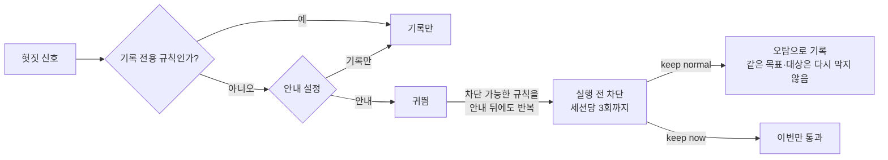

# 설정·동작 상세

설치를 처음 한다면 [사용 가이드](getting-started.md)를 먼저 읽으세요. 이 문서는 차단 조건, 선택 기능, 복구 범위를 확인할 때 사용합니다.

- [차단 조건](#귀띔에서-차단까지)
- [외부 원인으로 인한 수정 보류](#코드-밖-원인과-수정-보류)
- [장시간 작업과 상한](#장시간-세션)
- [파일 되돌리기](#되돌리기)
- [설정 권한](#설정-권한)
- [개인정보](#인수인계와-개인정보)

## 설정 파일

사용자 설정은 `~/.samcheonpo/config.yml`, 프로젝트 설정은 `.samcheonpo.yml`입니다. `samcheonpo init`은 프로젝트 설정 파일을 만듭니다. 기존 파일을 통째로 교체하지 말고 필요한 항목을 합치세요.

```yaml
language: auto             # 기본값. 사용자가 쓴 언어에 맞춰 안내. ko 또는 en으로 고정 가능
currency: auto             # 기본값. 한국어는 원, 영어는 달러. KRW 또는 USD로 고정 가능
rollout:
  mode: recommend          # 기본값. shadow는 일반 경고를 기록만
  escalate_max_blocks: 3   # 반복 경고의 차단 상한. 0이면 이 상승 차단을 끔
contract:
  draft: off               # 기본값. on이면 계약 초안 요청
detectors:
  s1_verify_treadmill:
    full_checks_per_request: 1  # 요청당 전체 시험 횟수. 0이면 끔
    full_check_commands: []     # 전체 시험으로 셀 프로젝트 검사 명령 일부
quality:
  enabled: true             # 범위 축소, 숨긴 잔여 작업, 미확인 화면에서 종료를 막음
  critique:
    enabled: false           # true면 코드 변경 뒤 samcheonpo critique 독립 검토를 요구. 사용자 설정에서만 켬
    min_lines: 30            # 검토를 요구하는 최소 변경 줄 수
    command: []              # 검토 명령. 비우면 작업 중인 에이전트의 기본 명령(claude, codex, mcode, agy, copilot, cursor)을 쓰고, 그 외에는 claude를 쓴다. {prompt}는 프롬프트 인자, {cwd}는 빈 폴더로 바뀐다
trim:
  enabled: false           # 기본값. true면 에이전트가 쓴 문서마다 덜어내기 단계를 요청당 한 번 안내
```

보호 경로·수락한 예산은 반복 경고의 차단 상한과 별개입니다. 프로젝트가 바꿀 수 있는 범위는 [설정 권한](#설정-권한)을 참고하세요.

## 작업 계약

삼천포가 완료 검사를 직접 실행하게 하려면 프로젝트에 `.samcheonpo/contract.yml`을 작성합니다. 계약 없이도 기록과 일부 경고·차단은 작동합니다.

```yaml
goal: 로그인 세션이 만료되면 재로그인 화면으로 보낸다
done:
  - check: "pytest -q tests/test_session.py"
scope:
  allow: ["src/auth/**", "tests/**"]
  protect: ["migrations/**"]
budget: {krw: 5000, minutes: 40}
```

사용자 터미널에서 내용과 실행할 검사 명령을 확인한 뒤 수락합니다.

```sh
samcheonpo contract show
samcheonpo contract accept
samcheonpo cmd check
```

예산과 보호 경로는 수락 뒤 적용됩니다. 계약을 수정하면 다시 수락해야 합니다.

### 완료 조건의 시험 고정

계약을 수락하면 `done` 검사가 실행하는 시험 파일과, 그 시험의 수집·실행 방식을 바꾸는 파일(`conftest.py`, `pytest.ini`, `pyproject.toml`의 `[tool.pytest]` 구간, `jest.config.*`, `vitest.config.*`, `TestMain`이 있는 Go 시험 파일)이 함께 고정됩니다. 수락 화면에 고정한 파일 수가 나옵니다. 명령만 보고 시험 파일을 알 수 없는 검사(예: 패턴 없는 `jest`, `make test`)는 고정하지 않았다고 따로 알려 줍니다.

- 수락한 계약이 있는 동안 고정 파일을 바꾸는 쓰기는 Write·Edit든 셸 명령(`sed -i`, 리디렉션, `cp`, `mv`, `rm`, `git checkout`, `git apply` 등)이든 `s3.protected_path`로 막힙니다. 고정 시험이 있는 폴더나 그 위 폴더에 수집 설정 파일을 새로 만드는 것도 같습니다.
- 훅을 거치지 않고 고정 파일이 바뀌면(데몬이 꺼진 동안의 편집 등) 계약 상태가 `stale`로 바뀝니다.
- 시험을 바꿔도 된다고 판단하면 `/samcheonpo:edit`로 계약을 고치고 다시 수락합니다. 다시 수락하면 그때의 시험 내용이 새 완료 기준이 됩니다.
- `simplify_tests: true`여도 고정은 그대로 유지됩니다.

```yaml
pin_tests: done                  # 기본값. done 검사가 실행하는 시험을 고정
# pin_tests: none                # 고정하지 않음
# pin_tests: ["tests/api/**"]    # done 검사의 시험에 더해 이 경로도 고정
```

### 변경 전 코드 대조

에이전트가 만들었거나 고친 시험이 통과하면, 삼천포가 같은 명령을 세션 전 기능 코드에 한 번 더 돌려 봅니다. 시험 파일은 통과한 시점의 내용으로 두고, 세션이 바꾼 기능 파일만 세션 시작 때 내용으로 되돌린 분리 작업 트리에서 실행합니다. 사용자 작업 폴더는 바뀌지 않습니다.

| 결과 | 뜻 |
|-|-|
| 변경을 확인함 | 바꾼 시험이 변경 전 코드에서는 실패한다 |
| 변경 없이도 통과(`s5.false_done`, `baseline_pass`) | 바꾼 시험이 변경 전 코드에서도 통과한다. 이 시험으로는 변경이 동작하는지 알 수 없다 |
| 동작 보존 확인 | 리팩터링·이름 변경 요청에서 변경 전후 모두 통과했다 |
| 약한 증거 | 변경 전 코드에서는 빌드나 수집 단계에서 멈춘다. 새 코드가 있는지만 확인했다 |
| 대조 불가 | 코드 밖 원인, 시간 초과, 다른 시험의 실패, git 저장소가 아님 등. 사유가 함께 나온다 |

```yaml
verify:
  baseline: contract   # 기본값. 계약 done 검사 중 pure: true 또는 isolation: worktree인 검사만 대조
  # baseline: auto     # 에이전트가 돌린 시험 명령도 대조. 네트워크를 분리할 수 있을 때만 실행
  # baseline: off      # 대조하지 않음
```

- 대조는 데몬이 백그라운드에서 하며 훅 응답을 늦추지 않습니다. 시간 제한은 원래 실행 시간의 3배(최소 10초, 최대 120초)입니다. 세션이 끝날 때 대조가 아직 돌고 있으면 영수증은 대조가 끝난 뒤에 씁니다.
- 완료 조건 명령이 파일을 쓰는 다른 명령 뒤에 `;`, `&&`, 줄바꿈으로 이어져 있어도 대조합니다. 이때도 다시 돌리는 명령은 계약에 적힌 검사 하나입니다. 출력을 파이프로 넘기거나(`| tail`) 뒤에 다른 명령을 붙이면 종료 코드가 시험의 것이 아니므로 대조하지 않습니다.
- 대조를 시작할 때 같은 작업 폴더에서 무거운 검사가 돌고 있으면 30초까지 기다립니다. 대조 중에 에이전트가 무거운 검사를 시작하면 대조를 멈춥니다. 대조 실행은 에이전트의 시험 횟수에 세지 않습니다.
- `node_modules`, `.venv`, `venv`는 원래 작업 폴더의 것을 연결해 쓰고, Rust는 삼천포 전용 `CARGO_TARGET_DIR`을 씁니다. 다른 이름의 가상 환경(예: `env/`)은 연결하지 않으므로 대조 불가(코드 밖 원인)로 나옵니다.
- 세션 시작 상태를 기록하는 동안 에이전트가 파일을 바꾸면 그 기록을 쓰지 않고 대조 불가로 남깁니다.
- `auto`의 네트워크 분리는 Unix 소켓으로 붙는 로컬 데이터베이스까지 막지 못합니다.
- 프로젝트 설정은 이 값을 사용자 설정보다 넓힐 수 없습니다.

### 바뀐 줄 변이 시험

`samcheonpo mutants`는 바뀐 기능 코드의 줄만 일부러 망가뜨려 보고, 시험이 그 변화를 잡는지 확인합니다. 사용자가 직접 실행하거나 계약 `done` 검사로 넣을 때만 돕니다.

```sh
samcheonpo mutants                       # HEAD 이후 바뀐 줄
samcheonpo mutants --base main           # main 이후 바뀐 줄
samcheonpo mutants --session SESSION_ID  # 세션이 시작한 뒤 바뀐 줄. 결과를 그 세션 영수증에 붙인다
```

| 언어 | 도구 | 범위 |
|-|-|-|
| Rust | cargo-mutants | 바뀐 줄 |
| Go | go-mutesting | 바뀐 줄 |
| JS·TS | StrykerJS(`node_modules`에 설치) | 바뀐 줄 |
| PHP | Infection(`vendor/bin`에 설치) | 바뀐 줄 |
| Java | PIT(Maven, JUnit 5는 `pitest-junit5-plugin` 설정 필요) | 바뀐 줄(클래스 전체를 변이하고 바뀐 줄의 결과만 셉니다) |
| Python | mutmut | mutmut 3은 바뀐 줄이 든 함수, mutmut 2는 바뀐 파일 전체 |

- 삼천포는 도구를 설치하지 않습니다. 도구가 없으면 설치 명령을 한 줄로 알리고 끝납니다. 계약 `done`에 `samcheonpo mutants`가 있으면 `samcheonpo doctor`도 빠진 도구를 알려 줍니다.
- Infection은 코드 커버리지가 필요합니다. pcov나 Xdebug가 없고 `phpdbg`가 있으면 `phpdbg -qrr`로 실행합니다.
- mutmut은 프로젝트 폴더에 `mutants/`를, StrykerJS는 `reports/`를 만듭니다. 필요하면 `.gitignore`에 넣습니다.
- 결과는 "바뀐 줄의 변이 N개 중 시험이 잡지 못한 변이 M개"와 살아남은 변이의 위치입니다. 증거로 보여 줄 뿐 차단 근거로 쓰지 않습니다.
- 바뀐 줄만 다루므로 다른 곳의 변경으로 생긴 시험 공백은 찾지 못합니다. 전체 변이 실행을 대신하지 않습니다.
- `--session`의 시작 상태는 변경 전 코드 대조가 켜진 세션에서만 기록됩니다. 기록이 없으면 HEAD 이후 변경을 씁니다.

`budget`에는 `artifact_gb`(세션 중 빌드 산출물 증가 한도)와 `verify_minutes`(검사 실행 시간 합계 한도)도 적을 수 있습니다. `minutes`는 세션이 활동한 시간입니다. 이 두 한도를 넘으면 전체 시험처럼 무거운 검사만 막고 바뀐 범위의 시험은 그대로 둡니다. 문서·화면 등 결과물 파일을 검사에 연결하려면 [완료 조건 예시](agent-failure-controls.md#문서화면데이터를-완료-조건에-연결하기)를 참고하세요.

운영 환경이 있는 프로젝트는 `production`에 운영 쪽을 적습니다. 모든 항목은 선택입니다.

```yaml
production:
  env_files: [".env.production"]    # 운영 접속 설정 파일 (없으면 .env.production, .env.prod)
  hosts: ["db.internal"]            # 운영 데이터베이스 호스트
  services: ["myapp.service"]      # 운영 systemd 유닛. 재시작·중지를 배포로 본다
  deploy_commands: ["bash scripts/deploy.sh"]
  allow_write: false                # true면 운영 데이터 쓰기를 허용한다
```

이 항목을 수락하면 운영 데이터베이스 쓰기(`s3.production_guard`)는 처음부터 막습니다. 계약이 없거나 `production`이 없으면 같은 쓰기를 안내(`s3.production_write`)로 시작하고, 안내 뒤에도 반복하면 막습니다.

운영으로 보는 쓰기는 두 가지입니다. 하나는 같은 명령이 운영 설정 파일을 읽고 별도 접속 대상을 적지 않은 쓰기이고, 다른 하나는 계약의 운영 호스트를 적은 쓰기입니다. `psql -f 파일`처럼 파일 안에 든 문장은 읽지 않습니다. 마이그레이션 이력 테이블(`_sqlx_migrations`, `schema_migrations` 등)을 손으로 바꾸는 문장은 운영 여부와 관계없이 안내합니다(`s3.migration_history_write`). 다만 접속 대상으로 이 컴퓨터만 적은 명령은 제외합니다. `check`는 지정된 명령을 실제로 실행합니다. 사람의 검토가 필요한 조건은 수동 인수 항목으로 지정합니다.

## 귀띔에서 차단까지



- 기본은 안내 모드(`rollout.mode: recommend`)다. `shadow`에서는 일반 판정을 기록하고 안내·복구 권고·자동 종료 검사를 생략한다. 수락한 보호 경로·예산과 오류 은폐·시험 약화·수락 범위 밖 수정·반복 되돌리기의 핵심 사전 차단은 유지한다.
- 기록만 하는 규칙도 있다. 기본 목록에는 `s1.verify_after_docs`, `s1.review_repeat`, `s1.explicit_waiting`, `s8.progress_stall`과 [요청과 보고 대조](#요청과-보고-대조)의 규칙이 들어 있다. 대기·정체 두 규칙은 사용자가 안내를 켜야 메시지를 보내며, 반복돼도 작업을 차단하지 않는다.
- 반복 경고에 따른 차단은 같은 세션·목표 안에서 안내를 받은 뒤 같은 대상(파일 또는 명령)에 같은 행동을 반복할 때 적용한다.
- 같은 검사 재실행, 실패 반복, 오류 숨기기, 시험 약화, 작은 변경 뒤 전체 시험 재실행, CI 실패 뒤 재배포, 배포 연타, 프로브 없는 장시간 실행, 거부당한 명령의 재실행, 같은 작업 폴더의 무거운 시험 겹침, 검사 없는 운영 배포(`s5.deploy_without_preflight`), 운영 데이터 쓰기, 마이그레이션 이력 수동 변경, 작업 경위를 적은 글의 커밋·푸시(`s5.artifact_meta`)는 계약 없이도 차단까지 간다. 답변 군더더기(`s5.answer_padding`)와 요청 없는 버튼·링크(`s3.unrequested_ui_action`)는 안내만 한다. 범위, 완료 조건, 검증 비율처럼 계약에 기대는 규칙은 수락한 계약이 있을 때만 차단한다.
- 세션당 차단 상한은 `rollout.escalate_max_blocks`(기본 3, 0이면 끔)다.
- 복구 권고는 규칙마다 계약 개정당 3번까지 보낸다. 한 규칙이 이 수를 다 써도 다른 규칙의 첫 판정은 전달된다. 전달되지 않은 판정에는 이유가 하나씩 남고, `samcheonpo rules evaluate`가 규칙별로 센다. 이유는 기록 전용 규칙(`shadow`), 같은 판정의 연속 억제(`cooldown`), 같은 원인에 열린 권고가 있음(`recovery_open`), 규칙의 권고 수 소진(`recovery_budget`), 호스트가 그 시점에 전달할 수 없음(`unsupported_route`), 권고를 실어 갈 훅이 오지 않음(`not_carried`) 등이다.
- `samcheonpo review`로 경고가 맞았는지 기록할 수 있다. 이 결과는 `accuracy`에서 규칙별로 확인한다.
- 사용자가 수락한 보호 경로와 명시한 예산은 어느 단계에서도 지킨다.
- `keep normal`은 현재 목표 안의 같은 규칙·같은 대상에만 적용된다. 다른 대상과 새 목표, 보호 경로와 예산에는 영향이 없다. `keep now`는 이번 한 번만 넘기고, 같은 일이 다시 생기면 막기 전에 먼저 안내한다. 종료 보류에서는 다음 종료 한 번을 보류하지 않는다.
- 검사 없는 종료의 보류는 같은 변경에 `levels.max_stop_holds`(기본 2, 0이면 검사가 통과할 때까지)번까지다. 그 뒤에는 미검증 종료로 기록하고 설정한 알림 경로로 전달한다. 마지막 변경 뒤에 삼천포가 변경 파일과 연결할 수 없는 검사(Gradle·Maven, 파이프로 이은 명령)가 통과했으면 보류하지 않고 같은 방식으로 알린다. `.idea/`, `*.iml`, `node_modules/`와 프로젝트 최상위의 `target/`·`dist/` 변경은 보류 대상에서 제외한다. 소스 안의 `src/target/` 같은 폴더는 검사한다.

## 코드 밖 원인과 수정 보류

실패한 명령의 출력과 종료 코드로 원인을 나눈다. 설치되지 않은 의존성·명령, 실행 권한 없음, 주소 해석 실패, 접속 거부, 권한 없음, 포트 점유, 인증 거부, 디스크 부족은 코드 밖 원인이다.

같은 명령이 작업 폴더 변화 없이 같은 코드 밖 원인으로 두 번 실패하면, 원인이 풀릴 때까지 소스 파일 쓰기를 실행 전에 보류하고 사람이 실행할 명령을 알려 준다. 사용자 화면에는 "사람이 확인할 일: `npm install yaml`"처럼 나온다.

- 의존성 선언 파일(`package.json`, `requirements.txt`, `go.mod` 등)과 `.samcheonpo/`는 보류 중에도 쓸 수 있다.
- 같은 명령이 통과하거나, 설치·서비스 기동 명령이 성공하거나, `/samcheonpo:keep normal`로 풀면 보류가 끝난다.
- 이름 해석 일시 실패, 시간 초과, 연결 끊김 같은 일시 장애는 재시도 기회를 준다. 종료 코드 124(시간 초과)와 137(강제 종료)은 코드 원인일 수 있어 보류하지 않는다.
- 보류도 다른 차단과 같이 귀띔이 먼저 가고, 세션당 차단 상한 안에서만 거부한다.

## 장시간 세션

오래 도는 세션에서 시간을 크게 잃는 행동은 따로 판정한다.

- **작은 변경 뒤 오래 걸리는 시험 재실행.** 지난번 실행이 `expensive_check_sec`(기본 300초) 이상 걸린 시험이 대상이다. 바뀐 파일과 연결된 시험이 먼저 통과했으면 전체 시험 한 번은 허용한다. 실행 스크립트로 감싸거나 스크립트 이름을 바꿔도 같은 시험으로 본다.
- **짧은 확인 없는 장시간 실행.** 실행 시간을 명시한 부하·장시간 실행(`k6 run --duration 2h`, `locust -t 30m`)은 300초까지 바로 허용하고, 그보다 길면 같은 대상의 짧은 실행이 통과한 길이의 6배까지만 허용한다. 코드가 바뀌면 그 기록은 무효가 된다. `timeout 600 npm test`의 `timeout`은 상한일 뿐 실행 시간으로 보지 않는다.
- **CI 실패 뒤 재배포.** `gh run watch/view/list`, `gh pr checks`, `glab ci`로 원격 CI 실패를 확인한 뒤 다시 배포하려면, CI가 지목한 실패 시험이나 전체 범위·장시간 검사가 로컬에서 통과해야 한다. 직전 배포 뒤 고친 내용에 통과한 검사가 없거나, 브라우저 시험이 타이밍으로 실패한 상태이거나, 한 시간에 `releases_per_hour`(기본 2)번을 넘겨 배포해도 판정한다. 태그가 바뀌어도 같은 판정이다.
- **실패한 CI를 그대로 다시 돌리기.** 같은 커밋의 실패한 CI를 `gh run rerun`·`glab ci retry`로 다시 돌려 또 실패하면 헛짓으로 센다. 다시 돌린 CI가 통과하면(불안정한 실패) 세지 않는다.
- **세션 길이.** 활동 시간 2시간 또는 토큰(입력·출력·캐시 쓰기) 1천만이면 상태줄에 표시하고, 4시간 또는 3천만이면 계속할지 묻는다. 활동 시간은 이벤트 사이 공백이 30분을 넘는 구간을 빼고 센다.
- **세션 상한.** `detectors.s8_cost.ceiling_hours`·`ceiling_tokens`나 계약의 `budget.minutes`로 상한을 정하면, 넘는 순간부터 파일 변경·검사·명령 실행·서브에이전트 호출을 거부하고 읽기만 허용한다. `/samcheonpo:extend 2h`(토큰은 `20M`처럼 대문자)로만 늘릴 수 있고 `keep`으로는 풀리지 않는다.

### 대기 반복·진행 정체 안내 켜기

작업이 끝났는데 계속 기다리거나, 수정해도 같은 검사에서 실패가 줄지 않는지 살펴본다. 기본으로는 기록만 남긴다. 안내를 받으려면 사용자 설정 `~/.samcheonpo/config.yml`에 아래 항목을 합친다.

```yaml
rollout:
  mode: recommend
  recommend_rules: [s1.explicit_waiting, s8.progress_stall]
```

첫 이름은 대기 반복, 두 번째 이름은 진행 정체 규칙이다. 하나만 선택해도 된다. 기존 `shadow_rules` 목록에도 같은 규칙이 있으면 그 목록에서는 빼야 안내한다. 프로젝트에서 기록 전용으로 지정한 규칙은 계속 기록만 한다.

안내에 필요한 근거는 다음과 같다.

- **대기 반복:** 수락한 계약의 완료 검사와 필요한 관찰이 끝났는지 확인할 수 있어야 한다.
- **진행 정체:** 같은 검사에서 입력이 바뀌었는지, 실패가 줄었는지 비교할 수 있어야 한다. 현재는 삼천포가 직접 실행한 v2 계약 검사를 사용한다.

기다리는 이유를 모르거나 파일 감시에 실패하면 판단을 보류한다. 사람이 확인할 완료 조건이 포함된 계약은 대기 안내를 보류한다. 두 규칙은 가벼운 안내만 하며 작업을 차단하거나 예산 상한을 늘리지 않는다. 상세 조건과 기록 평가 방법은 [대기 반복·진행 정체 안내](spec/agenttime-reliability.md)에 있다.

### 검사와 경고 기록 보기

프로젝트에서 `samcheonpo contract show`로 완료 조건을 확인합니다. 조건을 수정했다면 사용자 터미널에서 `samcheonpo contract accept`로 수락한 뒤 `samcheonpo cmd check`로 검사합니다. 조사·문서 작업은 결과물을 검사 대상으로 지정할 수 있습니다.

| 명령 | 조회 내용 |
| --- | --- |
| `samcheonpo evidence --session SESSION_ID` | 요구사항 상태와 실행한 검사 |
| `samcheonpo interventions --session SESSION_ID --json` | 경고·실행 전 차단·종료 보류의 상세 기록 |
| `samcheonpo interventions --since 30d --by-agent` | 에이전트·규칙별 안내와 차단 집계 |
| `samcheonpo outcomes --since 30d` | 경고 뒤 검사 통과·재실행·재발 등 후속 행동 |
| `samcheonpo review` | 경고가 맞았는지 사용자 판단 기록 |
| `samcheonpo accuracy --since 30d` | 규칙별 후속 관측과 사용자 판단 집계 |
| `samcheonpo provenance RULE_ID` | 규칙에 연결된 원장 근거의 해시 요약 |
| `samcheonpo rules evaluate` | 규칙별 판정·전달·차단·효과 관측 수와 전달되지 않은 이유, 질책과 맞은 판정 수 |
| `samcheonpo rules reproach-replay` | 지난 대화 기록의 질책을 다시 읽어 원장 판정과 맞춘 집계 |
| `samcheonpo rules corrections` | 사용자 교정에서 만든 규칙 후보와 승인한 규칙 |

`outcomes`는 경고 뒤 도구 호출 20번을 기본 관측 구간으로 사용합니다. `--window`로 구간을 바꾸고 `--by-arm`으로 안내 문구별 결과를 비교합니다.

`accuracy`의 판정정밀도는 사용자가 맞다고 확인한 건수를 전체 사용자 판단 건수로 나눈 값입니다. 재발 여부는 별도 열에서 볼 수 있습니다. `provenance`의 해시는 같은 원장 근거를 대조할 때 사용합니다.

## 요청과 보고 대조

사용자가 요청한 결과물과 금지한 행동, 에이전트가 보고한 내용을 기록과 맞춰 본다. 처음에는 대부분 기록만 하고, 지난 대화 기록을 재생해 오탐이 적다고 확인된 종류부터 안내나 보류로 올린다.

| 규칙 | 판정 | 기본 수준 |
| --- | --- | --- |
| `s5.deliverable_missing` | 완료라고 답했는데 요청한 릴리즈·태그·푸시·커밋·삭제·PR이 기록에 없다 | 기록만 |
| `s5.forbidden_action` | "푸시는 하지 마"처럼 금지한 행동을 실행하려 한다 | 기록만 |
| `s5.unrequested_external` | 요청에 없는 PR·이슈·리뷰 댓글을 만들려 한다 | 기록만 |
| `s5.claim_contradiction` | 통과했다는 검사가 실패로 끝났거나, 지웠다는 파일이 남아 있거나, 만들었다는 파일이 없다 | 기록만 |
| `s5.answer_language` | 한국어 요청에 영어로 답했다(영어 산출물을 요청한 경우 제외) | 종료 보류, 요청당 한 번 |
| `s1.known_result` | 같은 시험, 같은 인자로 이미 통과한 검사를 코드가 그대로인 채 다시 시작한다(문서만 바뀐 경우 포함) | 기록만 |
| `s1.duplicate_running` | 같은 검사가 같은 작업 폴더에서 이미 돌고 있다 | 기록만 |

- 요청 문장에서 행동을 읽을 때 질문("PR해도 되겠어?")은 요청이 아니다. "테스트 통과하면 릴리즈"처럼 조건이 붙은 요청은 완료 판정에 쓰지 않는다. 나중 요청이 앞의 요청을 이긴다. 금지한 행동을 다시 요청하면 금지가 풀린다.
- 명령으로 확인할 수 없는 결과물은 "관측 불가"로 기록하고 판정하지 않는다. 경로 없이 "지워"라고 한 요청, 메일·메시지 전송, 계약에 `production.deploy_commands`가 없는 배포, 래퍼 스크립트로 한 릴리즈·배포가 여기에 든다. 태그를 푸시한 뒤의 릴리즈도 CI가 만들 수 있어 관측 불가로 둔다.
- 결과를 아는 검사는 시험 명령과 선택 인자(`-run`, `-k`, `-t` 등)가 같고, 마지막 통과 뒤 바뀐 파일이 없거나 문서(`*.md`, `*.rst`, `*.txt`, `LICENSE`)뿐일 때만 판정한다. 넓은 검사 통과 뒤의 좁은 재실행은 판정하지 않는다. 통과 뒤에 사용자가 다시 돌려 달라고 하면 판정하지 않는다.

### 교정 규칙

"앞으로 PR 만들지 마", "문서만 바꿨으면 시험 돌리지 마"처럼 사용자가 준 교정을 실행할 수 있는 규칙으로 바꿔 둔다. 대화의 원문은 저장하지 않고, 정해진 형식의 규칙 문장과 메시지 해시만 남긴다.

- "앞으로", "항상", "이 프로젝트에서는"처럼 계속 적용할 범위를 말했거나 같은 교정이 다른 세션에서 두 번 나오면 규칙 후보가 된다. 후보는 위반 횟수만 센다(`s5.correction_candidate`).
- 후보는 영수증 끝에 승인 명령과 함께 나온다. `samcheonpo rules corrections approve ID`로 승인하면 그 프로젝트의 다음 요청부터 실행 전에 막는다(`s5.correction_repeat`, "같은 지적 N번째"). `withdraw`로 거둔다.
- 지금 요청이 규칙과 다른 것을 원하면 지금 요청을 따른다. 승인한 "PR을 만들지 않는다" 규칙이 있어도 "이번엔 PR 만들어"라고 하면 통과한다.
- 만들 수 있는 규칙은 금지 행동(PR·푸시·릴리즈·태그·배포·커밋·삭제·전송, 전체 시험, 문서만 바뀐 뒤의 시험, 새 브랜치), 끝내기 전에 할 행동("릴리즈까지 해"), 한국어로 답하기, 쓰지 말아야 할 경로다.

### 질책 기록

사용자 메시지가 에이전트를 질책하면 그 앞 요청 구간에 표시한다. 욕설과 "몇 번을 말해", "하라고 했잖아" 같은 반복 지적이 기준이다. 붙여 넣은 글, 코드 블록, 인용, 2,000자 이상의 메시지는 제외한다. 질책은 판정이나 차단을 만들지 않는다.

- 질책 주제(시험 반복, 결과물 누락, 지시 무시 등)와 그 구간에서 울린 규칙을 짝지어, 주제와 맞는 규칙만 "질책과 일치"로 센다. 맞는 규칙이 없으면 그 주제의 놓친 사례로 센다.
- 영수증 첫 줄에 질책 횟수, 같은 교정이 다시 나온 횟수, 질책 직전 구간의 비용을 쓴다. 사용자 입력이 없던 세션은 "질책 미관측"이라고 쓴다.
- 질책과 주제가 맞은 판정 구간은 `samcheonpo rules reproach-labels --out DIR`로 학습 라벨(`user_reproach` 등급)로 내보낼 수 있다. 이 등급은 사람 라벨이나 실행 기반 파생 라벨보다 약한 근거로 따로 센다.

### 예약 작업

예약 작업의 첫 요청에서 작업 식별자를 만든다. 호스트가 붙이는 안내 블록과 숫자를 뺀 본문의 해시다. 같은 작업의 회차가 10개 이상 쌓이면, 지금 회차가 지난 회차 중앙값의 3배를 넘을 때 안내한다(`s8.job_overrun`). 막는 것은 사용자가 한도를 정했을 때뿐이다.

```yaml
jobs:
  budget_tokens: 50000000   # 이 토큰 수를 넘으면 이후 호출을 거부
  stop_ratio: 5             # 중앙값의 5배를 넘으면 이후 호출을 거부
```

가격이 없는 모델의 토큰은 0원으로 합산하지 않는다. 세션 목록에는 토큰 수와 "가격 미설정"이 나오고, `samcheonpo price list`가 최근 30일 동안 가격 없이 쓴 모델을 보여 준다. 그 모델의 단가를 `~/.samcheonpo/prices.yml`에 넣으면 금액으로 합산한다.

## 되돌리기

`/samcheonpo:rollback`(터미널에서는 프로젝트 폴더에서 `samcheonpo cmd rollback`)은 AI가 쓰기 도구로 바꾼 파일을 마지막으로 검사가 통과한 시점으로 되돌린다. 그런 시점이 없으면 AI가 이 세션에서 처음 쓰기 전 상태가 기준이다.

1. 인자 없이 실행하면 미리보기와 계획 ID가 나온다.
2. `apply <계획 ID>`로 실행한다. 미리본 뒤 파일이 바뀌어 계획이 달라졌으면 적용하지 않는다.

대상 규칙:

- 쓰기 도구의 입력으로 결과를 재현할 수 있고, 실제 파일이 그 결과와 같았던 파일만 대상이다. AI 편집 사이에 다른 편집이 섞인 파일은 소유권 불명으로 뺀다.
- AI가 마지막으로 쓴 뒤 사용자나 다른 명령이 바꾼 파일은 건너뛴다.
- AI가 새로 만든 파일은 삭제한다.
- 프로젝트 밖으로 이어지는 경로, 심볼릭 링크, 하드링크, 특수 파일, 셸 명령으로 바뀐 파일, 1MB를 넘는 파일, 세션 보관 용량(64MB)을 넘긴 뒤의 파일은 대상이 아니다. 미리보기에 이유와 함께 나온다.
- 바꾸기 전 내용은 `~/.samcheonpo/backup/rollback/<세션>/<시각>/`에 백업하고, 실행 결과는 원장에 남긴다.

**기록된 통과 시점.** 검사가 통과할 때마다 그 시점의 AI 소유 파일을 `.samcheonpo/snapshots/<id>/`에 기록한다(최근 5개, 64MB 상한). 데몬이 다시 시작돼도 남는다. `/samcheonpo:rollback golden`으로 목록을 보고, `golden <id>`로 미리보기, `golden <id> apply <계획 ID>`로 실행한다. 소유권 규칙은 같고, 다른 세션의 AI가 쓴 파일은 대상이 아니다.

`.samcheonpo/`를 저장소의 `.gitignore`에 넣어 두면 기록이 커밋에 섞이지 않는다.

**분기(fork).** `samcheonpo fork`는 워크스페이스를 기록된 통과 시점으로 되돌리고 그 자리에서 새 세션을 시작한다. 기본은 미리보기이고 `--apply`를 붙여야 실제로 되돌린다.

1. 인자 없이 실행하면 기준 세션과 통과 시점, 되돌릴 파일 목록을 보여준다.
2. `--apply`로 되돌리고 새 세션을 연다. 복구한 파일은 임시 이름에 쓴 뒤 이름 바꾸기로 처리해 중간에 반쪽 쓴 파일이 보이지 않는다.
3. 실패한 세션은 지우지 않는다. 분기 상태로 남아 영수증에서 분기임을 알 수 있고, 새 세션의 첫 기록에 복구 안내가 남는다.

`samcheonpo fork --golden <id>`로 되돌릴 시점을 고르고, `--session <id>`로 기준 세션을 고른다. 통과 시점이 없으면 되돌릴 곳이 없다고 알리고 실행하지 않는다.

## 설정 권한

프로젝트의 `.samcheonpo.yml`은 사용자 설정(`~/.samcheonpo/config.yml`)을 아래 범위에서만 바꿀 수 있다.

| 항목 | 프로젝트 설정으로 할 수 있는 일 |
| --- | --- |
| 외부 프로그램(`iron_laws.path`), 알림 목적지(`notify.push`), 판정 모델(`detectors.s3_drift.judge`), 실험 모드(`experiment.enabled`) | 끄기만 |
| 탐지 기준, 귀띔·알림·정지 기준, 반복 대기, 종료 보류 횟수 | 느슨하게만 |
| 차단 상한, 군집 예산, 세션 상한(`ceiling_hours`·`ceiling_tokens`) | 낮추기만 |
| 검증 명령 목록(`verify_commands`) | 추가 |
| `rollout.mode`, `validated_rules`, `recommend_rules` | 사용자 단계·승인보다 확대 불가 |
| `rollout.shadow_rules` | 추가만, 사용자 목록 제거 불가 |

실험 모드는 기본으로 꺼져 있다. 사용자 설정(`~/.samcheonpo/config.yml`)에서 켠다.

```yaml
experiment:
  enabled: true
  arms: [none, prescription]   # none: 상황 안내, prescription: 다음 행동을 포함한 안내
```

켜면 세션마다 안내 문구 유형을 같은 확률로 배정합니다. `none`과 `fact`는 상황을 설명하고, `prescription`은 다음 행동을 함께 안내합니다. 보호 경로와 예산은 어느 유형에서도 동일하게 적용됩니다. 프로젝트 설정에서는 실험을 끌 수 있습니다.

`samcheonpo outcomes --by-arm`으로 문구 유형별 후속 행동을 비교합니다. 기간과 관측 구간은 해당 명령의 `--help`에서 확인합니다.

## 사용자 전용 명령

`accept`, `edit`, `skip`, `keep`, `extend`, `rollback apply`와 세션 밖의 `contract accept`는 사용자의 판단을 바꾸는 명령이다. 슬래시 명령이나 사용자 터미널에서만 동작하고, 에이전트가 셸 도구로 실행하면 실행 전에 거부한다. 스크립트에서 호출할 때도 같은 규칙을 적용한다. 문서에 사용 예시를 적는 것은 허용한다.

## 제거와 복구

```sh
samcheonpo uninstall --agent claude   # 설치한 에이전트마다 같은 --agent로
```

- 설치 후 사용자가 바꾼 상태줄은 덮어쓰지 않고 충돌을 알린다.
- 원장, 영수증, 기록, 실행 파일은 지우지 않는다. 실행 파일은 직접 정리한다.
- 생성 기록과 내용이 같은 파일만 제거한다. 사용자가 수정했거나 추가한 파일은 남기고 알린다.
- 설치나 제거가 실패하면 설치 기록과 백업을 그대로 두고, 다시 설치하기 전에 `doctor`로 원인을 확인한다.
- 설정 파일이 심볼릭 링크면 교체하지 않는다. 링크 대상의 실제 경로를 지정한다.

## 인수인계와 개인정보

`samcheonpo handoff <세션> --format json`과 `handoff inspect`로 다른 에이전트나 새 세션에 일을 넘긴다. 이 JSON에는 작업 내용을 담아 전달한다. 공유 전 목표·파일 경로·후속 요청을 확인한다.

작업 목표와 후속 요청은 재시작·인수인계를 위해 로컬 원장에 저장한다. `store_raw_text: false`는 원문 저장을 줄이는 설정이며 작업 카드와 이벤트 요약은 유지한다. 외부에 공유할 때는 `receipt --share` 또는 `export --redact`로 공유본을 만들고 내용을 확인한다.
