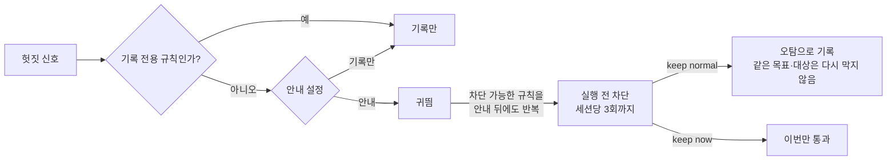

# 설정·동작 상세

설치를 처음 한다면 [사용 가이드](getting-started.md)를 먼저 읽으세요. 이 문서는 차단 조건, 선택 기능, 복구 범위를 확인할 때 사용합니다.

- [차단 조건](#귀띔에서-차단까지)
- [외부 원인으로 인한 수정 보류](#코드-밖-원인과-수정-보류)
- [장시간 작업과 상한](#장시간-세션)
- [파일 되돌리기](#되돌리기)
- [설정 권한](#설정-권한)
- [개인정보](#인수인계와-개인정보)

## 설정 파일

사용자 설정은 `~/.samcheonpo/config.yml`, 프로젝트 설정은 `.samcheonpo.yml`입니다. `samcheonpo init`은 프로젝트 설정 파일을 만듭니다. 기존 파일을 통째로 교체하지 말고 필요한 항목을 합치세요.

```yaml
rollout:
  mode: recommend          # 기본값. shadow는 기록만
  escalate_max_blocks: 3   # 반복 경고의 차단 상한. 0이면 이 상승 차단을 끔
contract:
  draft: off               # 기본값. on이면 계약 초안 요청
```

보호 경로·수락한 예산은 반복 경고의 차단 상한과 별개입니다. 프로젝트가 바꿀 수 있는 범위는 [설정 권한](#설정-권한)을 참고하세요.

## 작업 계약

삼천포가 완료 검사를 직접 실행하게 하려면 프로젝트에 `.samcheonpo/contract.yml`을 작성합니다. 계약 없이도 기록과 일부 경고·차단은 작동합니다.

```yaml
goal: 로그인 세션이 만료되면 재로그인 화면으로 보낸다
done:
  - check: "pytest -q tests/test_session.py"
scope:
  allow: ["src/auth/**", "tests/**"]
  protect: ["migrations/**"]
budget: {krw: 5000, minutes: 40}
```

사용자 터미널에서 내용과 실행할 검사 명령을 확인한 뒤 수락합니다.

```sh
samcheonpo contract show
samcheonpo contract accept
samcheonpo cmd check
```

예산과 보호 경로는 수락 뒤 적용됩니다. 계약을 수정하면 다시 수락해야 합니다. `check`는 지정된 명령을 실제로 실행합니다. 사람이 판단해야 하는 완료 조건까지 자동으로 확정하지 않습니다.

## 귀띔에서 차단까지



- 기본은 안내 모드(`rollout.mode: recommend`)다. 기록 전용 모드(`shadow`)에서는 판정만 저장한다. 안내·복구 권고·자동 검사 실행은 하지 않는다.
- 기록만 하는 규칙도 있다. 기본 목록은 `s1.verify_after_docs`, `s1.review_repeat`, `s1.explicit_waiting`, `s8.progress_stall`이다. 대기·정체 두 규칙은 사용자가 안내를 켜야 메시지를 보내며, 반복돼도 작업을 차단하지 않는다.
- 차단은 같은 세션, 같은 목표 안에서 귀띔을 받은 에이전트가 같은 규칙을 같은 대상(파일 또는 명령)에 다시 어길 때만 건다.
- 같은 검사 재실행, 실패 반복, 오류 숨기기, 시험 약화, 작은 변경 뒤 전체 시험 재실행, CI 실패 뒤 재배포, 배포 연타, 프로브 없는 장시간 실행, 거부당한 명령의 재실행은 계약 없이도 차단까지 간다. 범위, 완료 조건, 검증 비율처럼 계약에 기대는 규칙은 수락한 계약이 있을 때만 차단한다.
- 세션당 차단 상한은 `rollout.escalate_max_blocks`(기본 3, 0이면 끔)다.
- 사용자가 수락한 보호 경로와 명시한 예산은 어느 단계에서도 지킨다.
- `keep normal`은 현재 목표 안의 같은 규칙·같은 대상에만 적용된다. 다른 대상과 새 목표, 보호 경로와 예산에는 영향이 없다. `keep now`는 이번 한 번만 넘기고, 같은 일이 다시 생기면 막기 전에 먼저 안내한다.

## 코드 밖 원인과 수정 보류

실패한 명령의 출력과 종료 코드로 원인을 나눈다. 설치되지 않은 의존성·명령, 실행 권한 없음, 주소 해석 실패, 접속 거부, 권한 없음, 포트 점유, 인증 거부, 디스크 부족은 코드 밖 원인이다.

같은 명령이 작업 폴더 변화 없이 같은 코드 밖 원인으로 두 번 실패하면, 원인이 풀릴 때까지 소스 파일 쓰기를 실행 전에 보류하고 사람이 실행할 명령을 알려 준다. 사용자 화면에는 "사람이 확인할 일: `npm install yaml`"처럼 나온다.

- 의존성 선언 파일(`package.json`, `requirements.txt`, `go.mod` 등)과 `.samcheonpo/`는 보류 중에도 쓸 수 있다.
- 같은 명령이 통과하거나, 설치·서비스 기동 명령이 성공하거나, `/samcheonpo:keep normal`로 풀면 보류가 끝난다.
- 이름 해석 일시 실패, 시간 초과, 연결 끊김 같은 일시 장애는 재시도 기회를 준다. 종료 코드 124(시간 초과)와 137(강제 종료)은 코드 원인일 수 있어 보류하지 않는다.
- 보류도 다른 차단과 같이 귀띔이 먼저 가고, 세션당 차단 상한 안에서만 거부한다.

## 장시간 세션

오래 도는 세션에서 시간을 크게 잃는 행동은 따로 판정한다.

- **작은 변경 뒤 오래 걸리는 시험 재실행.** 지난번 실행이 `expensive_check_sec`(기본 300초) 이상 걸린 시험이 대상이다. 바뀐 파일과 연결된 시험이 먼저 통과했으면 전체 시험 한 번은 허용한다. 실행 스크립트로 감싸거나 스크립트 이름을 바꿔도 같은 시험으로 본다.
- **짧은 확인 없는 장시간 실행.** 실행 시간을 명시한 부하·장시간 실행(`k6 run --duration 2h`, `locust -t 30m`)은 300초까지 바로 허용하고, 그보다 길면 같은 대상의 짧은 실행이 통과한 길이의 6배까지만 허용한다. 코드가 바뀌면 그 기록은 무효가 된다. `timeout 600 npm test`의 `timeout`은 상한일 뿐 실행 시간으로 보지 않는다.
- **CI 실패 뒤 재배포.** `gh run watch/view/list`, `gh pr checks`, `glab ci`로 원격 CI 실패를 확인한 뒤 다시 배포하려면, CI가 지목한 실패 시험이나 전체 범위·장시간 검사가 로컬에서 통과해야 한다. 직전 배포 뒤 고친 내용에 통과한 검사가 없거나, 브라우저 시험이 타이밍으로 실패한 상태이거나, 한 시간에 `releases_per_hour`(기본 2)번을 넘겨 배포해도 판정한다. 태그가 바뀌어도 같은 판정이다.
- **실패한 CI를 그대로 다시 돌리기.** 같은 커밋의 실패한 CI를 `gh run rerun`·`glab ci retry`로 다시 돌려 또 실패하면 헛짓으로 센다. 다시 돌린 CI가 통과하면(불안정한 실패) 세지 않는다.
- **세션 길이.** 활동 시간 2시간 또는 토큰(입력·출력·캐시 쓰기) 1천만이면 상태줄에 표시하고, 4시간 또는 3천만이면 계속할지 묻는다. 활동 시간은 이벤트 사이 공백이 30분을 넘는 구간을 빼고 센다.
- **세션 상한.** `detectors.s8_cost.ceiling_hours`·`ceiling_tokens`나 계약의 `budget.minutes`로 상한을 정하면, 넘는 순간부터 파일 변경·검사·명령 실행·서브에이전트 호출을 거부하고 읽기만 허용한다. `/samcheonpo:extend 2h`(토큰은 `20M`처럼 대문자)로만 늘릴 수 있고 `keep`으로는 풀리지 않는다.

### 대기 반복·진행 정체 안내 켜기

작업이 끝났는데 계속 기다리거나, 수정해도 같은 검사에서 실패가 줄지 않는지 살펴본다. 기본으로는 기록만 남긴다. 안내를 받으려면 사용자 설정 `~/.samcheonpo/config.yml`에 아래 항목을 합친다.

```yaml
rollout:
  mode: recommend
  recommend_rules: [s1.explicit_waiting, s8.progress_stall]
```

첫 이름은 대기 반복, 두 번째 이름은 진행 정체 규칙이다. 하나만 선택해도 된다. 기존 `shadow_rules` 목록에도 같은 규칙이 있으면 그 목록에서는 빼야 안내한다. 프로젝트에서 기록 전용으로 지정한 규칙은 계속 기록만 한다.

안내에 필요한 근거는 다음과 같다.

- **대기 반복:** 수락한 계약의 완료 검사와 필요한 관찰이 끝났는지 확인할 수 있어야 한다.
- **진행 정체:** 같은 검사에서 입력이 바뀌었는지, 실패가 줄었는지 비교할 수 있어야 한다. 현재는 삼천포가 직접 실행한 v2 계약 검사를 사용한다.

기다리는 이유를 모르거나 파일 감시에 실패하면 판단을 보류한다. 사람이 확인할 완료 조건이 포함된 계약은 대기 안내를 보류한다. 두 규칙은 가벼운 안내만 하며 작업을 차단하거나 예산 상한을 늘리지 않는다. 상세 조건과 기록 평가 방법은 [대기 반복·진행 정체 안내](spec/agenttime-reliability.md)에 있다.

### 완료 근거가 미확인일 때

프로젝트에서 `samcheonpo contract show`로 조건을 확인하고, 필요하면 `.samcheonpo/contract.yml`의 완료 조건을 작성한다. 검토·조사 작업은 파일 변경 대신 결과물을 조건으로 삼을 수 있다. 사용자가 조건을 수락한 뒤 `samcheonpo contract accept`, `samcheonpo cmd check` 순서로 실제 검사를 확인한다. 수락만으로 통과가 되지는 않으며 사람이 확인할 조건은 별도로 남는다. 진단 명령은 수락이나 검사를 대신 실행하지 않는다.

`samcheonpo interventions --since 30d --by-agent`는 에이전트·규칙별 전달 단계와 미관측 사유를 보여 준다. 안내와 같은 실행의 후속 완료 결과 또는 관련 생산 행동을 확인해야 ‘재발 없음’으로 기록한다. 관련 행동이 없거나 외부 검사가 아직 확인되지 않으면 미관측이다. 재발이 없다는 기록은 해결이나 비용 절감의 증거가 아니다.

`samcheonpo outcomes --since 30d`는 경고마다 그 뒤 도구 호출 20번 안의 행동을 원장에서 다시 계산한다. 검사 통과, 같은 명령 재실행, 같은 규칙 재발, 시험 파일 수정, git 되돌림(`checkout --`, `restore`, `reset --hard`)이 나온 경고의 비율을 규칙별로 보여 준다. `--window`로 호출 수를 바꾸고, `--by-arm`으로 실험 군별로 나눈다. 경고를 보내지 않은 군(`none`)과 비교할 때만 차이를 경고의 효과로 읽을 수 있다.

`samcheonpo review`는 아직 판정하지 않은 경고를 규칙마다 돌아가며 기본 5건 보여 준다. 경고가 많은 규칙 하나가 판정을 독차지하지 않는다.

`samcheonpo accuracy --since 30d`는 원장에게 남은 기록만으로 규칙별 신뢰도를 실측한다. 제안·전달·‘재발 없음’·재발의 수와 사용자가 반박한 위양성을 한 표로 본다. 정밀도 추정은 ‘재발 없음’÷(‘재발 없음’+재발)이며 사용자 라벨이 없는 규칙에는 유의미한 수치가 없다. 이 명령은 처방을 스스로 평가하지 않고, 더 자세한 전달 단계는 `samcheonpo interventions`를 본다.

`samcheonpo provenance <규칙>`은 그 규칙의 원장 근거(차단·처방·피드백)를 정렬해 SHA256 다이제스트로 요약한다. 같은 원장에서 다시 실행하면 같은 값이 나오고, 원장에 한 건이라도 새 근거가 쌓이면 값이 바뀐다. 규칙 신뢰도를 발표·공유할 때는 이 다이제스트를 함께 적어 어느 원장의 기록인지 특정한다.

## 되돌리기

`/samcheonpo:rollback`(터미널에서는 프로젝트 폴더에서 `samcheonpo cmd rollback`)은 AI가 쓰기 도구로 바꾼 파일을 마지막으로 검사가 통과한 시점으로 되돌린다. 그런 시점이 없으면 AI가 이 세션에서 처음 쓰기 전 상태가 기준이다.

1. 인자 없이 실행하면 미리보기와 계획 ID가 나온다.
2. `apply <계획 ID>`로 실행한다. 미리본 뒤 파일이 바뀌어 계획이 달라졌으면 적용하지 않는다.

대상 규칙:

- 쓰기 도구의 입력으로 결과를 재현할 수 있고, 실제 파일이 그 결과와 같았던 파일만 대상이다. AI 편집 사이에 다른 편집이 섞인 파일은 소유권 불명으로 뺀다.
- AI가 마지막으로 쓴 뒤 사용자나 다른 명령이 바꾼 파일은 건너뛴다.
- AI가 새로 만든 파일은 삭제한다.
- 프로젝트 밖으로 이어지는 경로, 심볼릭 링크, 하드링크, 특수 파일, 셸 명령으로 바뀐 파일, 1MB를 넘는 파일, 세션 보관 용량(64MB)을 넘긴 뒤의 파일은 대상이 아니다. 미리보기에 이유와 함께 나온다.
- 바꾸기 전 내용은 `~/.samcheonpo/backup/rollback/<세션>/<시각>/`에 백업하고, 실행 결과는 원장에 남긴다.

**기록된 통과 시점.** 검사가 통과할 때마다 그 시점의 AI 소유 파일을 `.samcheonpo/snapshots/<id>/`에 기록한다(최근 5개, 64MB 상한). 데몬이 다시 시작돼도 남는다. `/samcheonpo:rollback golden`으로 목록을 보고, `golden <id>`로 미리보기, `golden <id> apply <계획 ID>`로 실행한다. 소유권 규칙은 같고, 다른 세션의 AI가 쓴 파일은 대상이 아니다.

`.samcheonpo/`를 저장소의 `.gitignore`에 넣어 두면 기록이 커밋에 섞이지 않는다.

**분기(fork).** `samcheonpo fork`는 워크스페이스를 기록된 통과 시점으로 되돌리고 그 자리에서 새 세션을 시작한다. 기본은 미리보기이고 `--apply`를 붙여야 실제로 되돌린다.

1. 인자 없이 실행하면 기준 세션과 통과 시점, 되돌릴 파일 목록을 보여준다.
2. `--apply`로 되돌리고 새 세션을 연다. 복구한 파일은 임시 이름에 쓴 뒤 이름 바꾸기로 처리해 중간에 반쪽 쓴 파일이 보이지 않는다.
3. 실패한 세션은 지우지 않는다. 분기 상태로 남아 영수증에서 분기임을 알 수 있고, 새 세션의 첫 기록에 복구 안내가 남는다.

`samcheonpo fork --golden <id>`로 되돌릴 시점을 고르고, `--session <id>`로 기준 세션을 고른다. 통과 시점이 없으면 되돌릴 곳이 없다고 알리고 실행하지 않는다.

## 설정 권한

프로젝트의 `.samcheonpo.yml`은 사용자 설정(`~/.samcheonpo/config.yml`)을 아래 범위에서만 바꿀 수 있다.

| 항목 | 프로젝트 설정으로 할 수 있는 일 |
| --- | --- |
| 외부 프로그램(`iron_laws.path`), 알림 목적지(`notify.push`), 판정 모델(`detectors.s3_drift.judge`), 실험 모드(`experiment.enabled`) | 끄기만 |
| 탐지 기준, 귀띔·알림·정지 기준, 반복 대기, 종료 보류 횟수 | 느슨하게만 |
| 차단 상한, 군집 예산, 세션 상한(`ceiling_hours`·`ceiling_tokens`) | 낮추기만 |
| 검증 명령 목록(`verify_commands`) | 추가 |
| `rollout.mode`, `validated_rules`, `recommend_rules` | 사용자 단계·승인보다 확대 불가 |
| `rollout.shadow_rules` | 추가만, 사용자 목록 제거 불가 |

실험 모드는 기본으로 꺼져 있다. 켜면 일부 안내를 대조군으로 보류해 전달하지 않고, 상태줄에 그 사실을 표시한다. 자세한 평가 절차는 [보고서 양식](benchmarks/report-template.md)에 있다.

## 사용자 전용 명령

`accept`, `edit`, `skip`, `keep`, `extend`, `rollback apply`와 세션 밖의 `contract accept`는 사용자의 판단을 바꾸는 명령이다. 슬래시 명령이나 사용자 터미널에서만 동작하고, 에이전트가 셸 도구로 실행하면 실행 전에 거부한다. 스크립트 안에서 부르는 것도 거부하지만, 파일에 쓰는 문서 안에 명령 이름이 있는 것은 실행으로 보지 않는다. 같은 OS 사용자로 도는 프로세스가 데몬 소켓에 직접 접속하는 것까지 막지는 않는다.

## 제거와 복구

```sh
samcheonpo uninstall --agent claude   # 설치한 에이전트마다 같은 --agent로
```

- 설치 후 사용자가 바꾼 상태줄은 덮어쓰지 않고 충돌을 알린다.
- 원장, 영수증, 기록, 실행 파일은 지우지 않는다. 실행 파일은 직접 정리한다.
- 생성 기록과 내용이 같은 파일만 제거한다. 사용자가 수정했거나 추가한 파일은 남기고 알린다.
- 설치나 제거가 실패하면 설치 기록과 백업을 그대로 두고, 다시 설치하기 전에 `doctor`로 원인을 확인한다.
- 설정 파일이 심볼릭 링크면 교체하지 않는다. 링크 대상의 실제 경로를 지정한다.

## 인수인계와 개인정보

`samcheonpo handoff <세션> --format json`과 `handoff inspect`로 다른 에이전트나 새 세션에 일을 넘긴다. 이 JSON은 원문을 담은 로컬 자료이므로 공개 공유용이 아니다.

작업 카드의 목표, 후속 요청, 출처는 재시작과 인수인계를 위해 로컬 원장에 남는다. `store_raw_text: false`도 작업 카드와 짧은 이벤트 요약까지 비식별화하지는 않는다. 계약, 원장, 인수인계 자료는 비공개로 다루고, 공유가 필요하면 `receipt --share`나 `export --redact` 결과를 검토한 뒤 공유한다.
