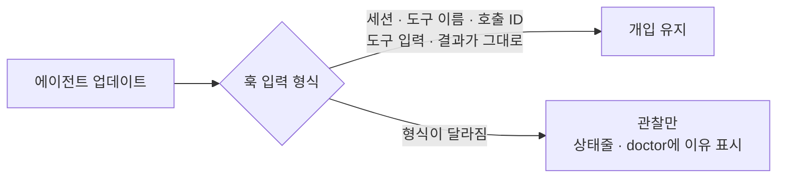

# 지원 범위

확인 수준은 세 가지다.

- **실제 실행**: 실제 에이전트 세션에서 훅이 불리고 판정·귀띔·차단이 전달되는 것을 확인했다.
- **CI 시험**: 해당 OS의 GitHub Actions 러너에서 데몬·훅·되돌리기·설치를 포함한 전체 시험과 적합성 사례가 통과한다.
- **미확인**: 빌드는 되지만 위 두 가지를 확인하지 않았다.

## 운영체제

| 환경 | 배포 파일 | 확인 수준 | 비고 |
| --- | --- | --- | --- |
| Linux x86-64 | 있음 | 실제 실행 | Claude Code, Codex, agy, Hermes, OpenClaw |
| Linux arm64 | 있음 | 배포 파일 설치 확인 | 실제 에이전트 실행 미확인 |
| macOS (amd64, arm64) | 있음 | CI 시험 | 실제 에이전트 실행 미확인 |
| Windows (x64, arm64) | 있음 | CI 시험, 실제 실행(arm64, Claude Code) | 다른 에이전트 미확인 |
| WSL | Linux 파일 사용 | 미확인 | |

배포 파일은 플랫폼마다 그 플랫폼의 러너에서 빌드하고, API 키 없는 설치·제거·감사·첫 훅 확인을 통과한 것만 올린다.

### Windows

- Windows 10 1803 이상이 필요하다(유닉스 도메인 소켓).
- 계약의 `check:` 같은 검사 명령은 Git for Windows의 `bash`로 실행한다. 없으면 `cmd.exe`로 실행되어 `&&`, `test -s`, 작은따옴표 같은 POSIX 문법이 같은 뜻으로 동작하지 않는다. `samcheonpo doctor`의 `shell` 항목에서 어느 쪽인지 확인한다.
- `bash.exe`를 직접 지정하려면 `SAMCHEONPO_SHELL`에 경로를 넣는다. System32의 `bash.exe`는 WSL 실행 파일이라 쓰지 않는다.
- 데몬 소켓 폴더(`%USERPROFILE%\.samcheonpo\run`)는 현재 사용자와 SYSTEM만 접근할 수 있고, 접속한 프로세스가 같은 사용자인지 확인한다.

## 에이전트

| 에이전트 | 연결 방식 | 개입 | 제약 |
| --- | --- | --- | --- |
| Claude Code 2.1.x | 플러그인 (훅, 상태줄, 슬래시 명령) | 귀띔, 실행 전 차단 | |
| Codex 0.160–0.162 | `~/.codex/hooks.json` | 귀띔, 실행 전 차단 | 상태줄과 슬래시 명령이 없어 `samcheonpo cmd`를 쓴다 |
| opencode 1.18.x | 전달용 플러그인 | 귀띔, 실행 전 차단 | |
| Antigravity(agy) 1.3.x | `~/.gemini/config/hooks.json`의 `samcheonpo` 묶음 | 다음 모델 호출에 귀띔, 실행 전 차단 | 훅이 도구 결과를 주지 않아 대화 기록에서 읽는다. 셸 결과는 다음 이벤트에 반영된다. 세션 종료 이벤트가 없어 종료 영수증을 만들지 않는다 |
| Hermes 0.21.x | 플러그인 + `hermes plugins enable` | 도구 결과에 귀띔, 실행 전 차단 | 종료 보류는 코드를 고친 차례에서만 불린다. 실행 중인 게이트웨이는 재시작해야 적용된다 |
| OpenClaw 2026.7.x | 플러그인 + `openclaw plugins install` | 다음 요청에 귀띔, 실행 전 차단 | 실행 중에 도구 결과를 모델에 보여 줄 훅이 없어 같은 실행 안의 반복은 막지 않는다. 실행 중인 게이트웨이는 재시작해야 적용된다 |
| GitHub Copilot, Cursor | 훅 | 관찰만 | |

표의 버전은 훅 입력을 실제로 수집해 시험에 넣은 범위다. 범위 밖 버전이라고 개입을 끄지는 않는다.



`samcheonpo doctor --agent <이름>`은 에이전트 버전, 연결 설정, 훅 형식 불일치 여부를 보여 준다. 버전이 범위 밖이라는 안내는 오류가 아니다. `hook_shape` 경고가 나오면 삼천포를 업데이트한다.

## 기능별 확인 범위

| 기능 | 실제 에이전트로 확인 | 시험으로만 확인 |
| --- | --- | --- |
| 같은 실패 반복의 귀띔과 실행 전 차단 | Claude Code, Codex, agy, Hermes, OpenClaw | |
| 코드 밖 원인 수정 보류 | Claude Code (보류 사유 전달) | 두 번째 쓰기 거부, `keep normal` 해제 |
| 통과 시점 기록과 `rollback golden` | Claude Code (기록, 목록, 미리보기) | `apply` (사용자 전용) |
| 전체 시험 재실행, 장시간 실행, 배포 연타, 반복 거부, 브라우저 타이밍, 세션 길이 | 지난 Codex 기록 감사에서 판정 | 실시간 귀띔·차단 전달 |
| 군집 예산, 압축 뒤 목표 재안내, HUD | | 흐름 시험, 적합성 사례 |
| 훅 형식에 따른 개입 유지와 관찰 전환 | 수집한 Codex 훅 입력 통과 | 형식이 바뀐 입력 |
| 완료 근거 뒤 명시적 대기 반복 (`s1.explicit_waiting`) | 미확인 | 로컬 판단·복원·합성 기록 시험. 기본은 기록만 |
| 입력 변화 뒤 관련 검사 실패 정체 (`s8.progress_stall`) | 미확인 | 로컬 판단·직접 검사 연결·합성 기록 시험. 기본은 기록만 |

시험에 통과한 기능이라도 바로 안내를 보내는 것은 아니다. 기록 전용 상태를 `shadow`라고 부른다. 기본 기록 전용 규칙은 `s1.verify_after_docs`, `s1.review_repeat`, `s1.explicit_waiting`, `s8.progress_stall`이다.

대기·정체 두 규칙의 안내는 사용자가 `rollout.recommend_rules`에서 켠다. 안내를 켜도 작업을 차단하지 않는다. 프로젝트 설정은 기록 전용 규칙을 추가할 수 있다. 사용자 설정에서 정한 기록 전용 규칙을 제거하거나 안내 권한을 추가할 수는 없다. 오탐은 `/samcheonpo:keep normal`로 알린다.

### 대기·정체 기능에서 확인한 것 (2026-10-10)

v0.6.0에 포함했으며 로컬 시험을 수행했다.

- 전체 Go 시험·관련 race 검사·vet와 적합성 20건을 통과했다. race 검사는 동시에 실행되는 코드의 충돌을 찾는 검사다.
- 합성 기록 6건으로 탐지 결과를 확인했다. 실제 AgentTime 기록의 성능 평가는 남아 있다.
- 훅 200회가 모두 응답했다. 시간 초과·실패·큐 누락은 0이었다. 처리 시간 p95는 2.53ms로, 요청 95%가 이 시간 안에 처리됐다.
- 호스트의 파일 감시 자원이 고갈돼(inotify `ENOSPC`) 마지막 검사에서 정상 감시가 필요한 통합 시험 2건을 건너뛰었다. 감시 실패·용량 초과 때 판단을 보류하는 동작은 별도로 시험했다.

실제 에이전트에서의 새 안내 전달은 아직 확인하지 않았다. 안내를 켠 경우와 끈 경우의 완료율·비용·오탐 비교(G12)도 남아 있다. 사용법과 제약은 [대기 반복·진행 정체 안내](spec/agenttime-reliability.md)에 있다.

## 성능

- 훅 처리 지연 목표는 p95 10ms다.
- 실행 전 판정은 15ms 안에 끝나야 차단으로 전달된다. 넘기면 실행을 막지 않고 상태줄에 `확인 불가`와 시간 초과 건수를 표시한다.

## 릴리스 후보 직접 만들기

```sh
sh scripts/package-release.sh 0.9.0-dev ./release-out
```

현재 플랫폼에서 두 실행 파일을 빌드하고, API 키 없는 격리 환경에서 설치·제거·감사·첫 훅을 확인한 뒤 `tar.gz`와 `SHA256SUMS`를 만든다. 출력 폴더가 이미 있으면 덮어쓰지 않고, 호스트와 대상 플랫폼이 다르면 거절한다. `BUILD.txt`에 버전, 커밋, 도구 체인, 작업 트리 변경 여부를 남긴다.

`.github/workflows/release.yml`은 수동 실행(`workflow_dispatch`)으로 여섯 플랫폼의 후보를 만들어 artifact로 올린다. 태그와 GitHub Release는 만들지 않는다.


## v0.8.0 추가 기능의 확인 범위

행동 반복·조사 반복·인계·부분 완료·요청 제약 위반 신규 후보는 기본 shadow이며 차단하지 않는다. 관련 Go 회귀·경쟁 조건 검사와 Claude/Codex 네이티브 형식 적합성은 통과했지만 실제 독립 사람 라벨 정밀도·재현율, 실시간 안내 수신·회복, on/off 완료율·총비용 효과는 미확인이다. 새 규칙의 안내는 사용자의 정확한 `recommend_rules` 선택이 필요하다.

웹 화면·구간 신고·고정 원본 보호·프로세스 간 저장 경합·원본/큐 결속·비교 지표는 시험으로 확인했다. 실제 자료 600구간에는 사람 정답이 없어 정확도는 미확인이다. Cursor CLI 인증 미비와 Copilot CLI의 호스트 파일 감시 한도로 이번 실제 연결 시험은 시작하지 못했으며 개입 지원을 확장하지 않는다. [검증 기록](benchmarks/2026-10-13-full-plan-validation.md)에 실제 자료와 남은 인수를 구분했다.

## v0.9.0 추가 기능의 확인 범위

감시 인스턴스 상한·회수, 감시 실패 표면화, 규칙 팩 읽기 실패 표면화, 실행 전 차단 집계, 세션 종료 전 분석 스냅샷, 종료되지 않은 세션 정리, 원장 보존 정리는 Go 회귀·경쟁 조건 검사로 확인했다. 실제 장시간 게이트웨이 세션에서 감시 인스턴스가 상한 아래에서 안정하는지, 데몬이 죽은 뒤 저장 분석으로 발급한 영수증이 봉인과 대조되는지는 시험으로만 확인했고 실제 운영 자료로 재확인하지 않았다.

`compact --prune-days`는 종료된 세션의 상세만 지우고 봉인·영수증·판정은 남긴다. 무엇이 지워지는지는 세션별로 확인해야 하며, 보존 기간을 운영 기준에 맞게 정한 뒤 쓰는 것이 좋다. 원장의 저널 모드와 진공 모드는 명시했다. 자동 진공(점진적 진공)은 페이지 이동을 커밋 경로에 얹기 때문에 쓰지 않는다. 이 호스트에서 켜니 600회 중 2회의 훅이 기한을 넘겨, 공간 회수는 명령으로만 한다.

`daemon_lost`·`idle_timeout`은 관측이 왜 끊겼는지를 기록할 뿐 에이전트 종료를 뜻하지 않는다. 이 사유가 붙은 영수증은 "종료 확인"이 아니라 "관측 중단"으로 읽어야 한다.

## v0.9.0 추가 기능의 확인 범위 (2026-10-21 추가)

실행 기반 골드 라벨 경로, 검증 가능 과제 제조기, 생중 probe, 회피 코퍼스, 판정 계보와 도출 시점 지표, 지시 밀수 규칙, 위험 등급 비용, 플러그인 무결성 기록, 오염 통제, 하네스 성분 위치 규격, 공개 노출 플래그는 Go 회귀 시험으로 확인했다. 아래는 시험으로 확인하지 못한 것이다.

- 실행 기반 파생 라벨의 **사람 라벨 정밀도**. 파생 라벨은 사람이 라벨한 것보다 약한 근거로 표시되며(`derived_execution`), 두 등급이 섞인 제안과 팩은 만들어지지 않는다. 파생 등급으로 승격된 규칙도 사용자 선택 없이는 차단되지 않는다.
- 생성 과제의 **독립 단위 수**. 계열이 7개이므로 독립 단위는 7개에 그친다. 생성으로 늘어나는 것은 시행 수지 독립 단위 수가 아니다.
- 생중 probe의 **효과 크기**. 판정 어휘(`helped | hurt | no observed effect | confounded`)와 거부(`NO_ENTRY`)만 쓴다. 시행이 부족하면 거절한다.
- 회피 코퍼스의 **포획률**. 9개 회피 시나리오와 4개 잡음 시나리오로 측정했다. 잡음이 늘면 오탐으로 드러난다.
- 최초 판정 시점 지표는 **탐지 지연**이지 탐지 정확도가 아니다. 채점기의 확정을 대신하지 않는다.
- 지시 밀수(S9) 탐지는 **지시의 존재**만 말한다. 지시자가 누구인지는 말하지 않고, 조립된 컨텍스트 어디에든 같은 형태의 문장이 있으면 반응한다. 실제 운영 자료의 오탐률은 아직 없다.
- 위험 등급 비용은 **판정 예산을 아낀 것**을 보이는 기능이지 탐지 정확도를 높인 기능이 아니다. 읽기만 하는 세션은 의미 판정을 호출하지 않는다.
- 플러그인 무결성 기록은 **서명이 아니다**. 설치할 때의 묶음이 지금 그대로인지만 확인한다. 그것을 배포한 사람이 누구인지는 확인하지 않는다.
- 오염 통제(S10)는 **벤치 경로에서만** 채점기 경로를 막는다. 채점기는 시행 디렉터리 밖으로 분리되며, 에이전트가 닿았는지는 결과 파일에 남지만 파일 시스템 수준의 완전한 격리는 아니다.
- 공개 노출 플래그는 **22개 기존 벤치 과제만** 표시한다. 생성 과제는 비공개로 본다. 공개 과제의 성공률은 더 약한 주장이다.
- S9·S10은 **낭비 증상 코드(S1~S8)에 들어가지 않는다**. 사람이 구간을 신고하는 증상 어휘는 그대로 두었다. 두 규칙은 비용을 낭비로 분류하지 않고 관찰 사실로만 남긴다. 새 규칙의 오탐률은 회피 코퍼스로 잰다.
