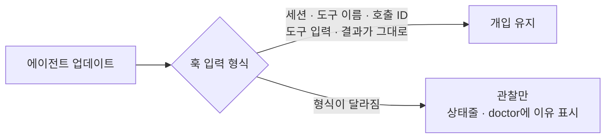

# 지원 범위

확인 수준은 세 가지다.

- **실제 실행**: 실제 에이전트 세션에서 훅이 불리고 판정·귀띔·차단이 전달되는 것을 확인했다.
- **CI 시험**: 해당 OS의 GitHub Actions 러너에서 데몬·훅·되돌리기·설치를 포함한 전체 시험과 적합성 사례가 통과한다.
- **미확인**: 빌드는 되지만 위 두 가지를 확인하지 않았다.

## 운영체제

| 환경 | 배포 파일 | 확인 수준 | 비고 |
| --- | --- | --- | --- |
| Linux x86-64 | 있음 | 실제 실행 | Claude Code, Codex, opencode, agy, Hermes, OpenClaw, MiniMax Code |
| Linux arm64 | 있음 | 배포 파일 설치 확인 | 실제 에이전트 실행 미확인 |
| macOS (amd64, arm64) | 있음 | CI 시험 | 실제 에이전트 실행 미확인 |
| Windows (x64, arm64) | 있음 | CI 시험, 실제 실행(arm64, Claude Code) | 다른 에이전트 미확인 |
| WSL | Linux 파일 사용 | 미확인 | |

배포 파일은 플랫폼마다 그 플랫폼의 러너에서 빌드하고, API 키 없는 설치·제거·감사·첫 훅 확인을 통과한 것만 올린다.

### Windows

- Windows 10 1803 이상이 필요하다(유닉스 도메인 소켓).
- **훅 전송기는 Windows에서 Go 구현을 쓴다.** unix에서는 Rust 구현(`crates/samcheonpo-hook`)이 배포된다. Rust 표준 라이브러리는 Windows의 유닉스 소켓 타입을 아직 불안정 기능으로 두고 있어(2026-10-22, Rust 1.97.1) Rust로 빌드하지 않는다. 두 구현은 같은 계약 명세와 같은 소켓 경로 벡터로 묶여 있고, `scripts/check-hook-contract.sh`가 양쪽을 함께 확인한다. Rust 전송기의 Windows 동작은 확인하지 않았다.
- 계약의 `check:` 같은 검사 명령은 Git for Windows의 `bash`로 실행한다. 없으면 `cmd.exe`로 실행되어 `&&`, `test -s`, 작은따옴표 같은 POSIX 문법이 같은 뜻으로 동작하지 않는다. `samcheonpo doctor`의 `shell` 항목에서 어느 쪽인지 확인한다.
- `bash.exe`를 직접 지정하려면 `SAMCHEONPO_SHELL`에 경로를 넣는다. System32의 `bash.exe`는 WSL 실행 파일이라 쓰지 않는다.
- 데몬 소켓 폴더(`%USERPROFILE%\.samcheonpo\run`)는 현재 사용자와 SYSTEM만 접근할 수 있고, 접속한 프로세스가 같은 사용자인지 확인한다.

## 에이전트

| 에이전트 | 연결 방식 | 개입 | 제약 |
| --- | --- | --- | --- |
| Claude Code 2.1.x | 플러그인 (훅, 상태줄, 슬래시 명령) | 귀띔, 실행 전 차단 | |
| Codex 0.160–0.163 | `~/.codex/hooks.json` | 귀띔, 실행 전 차단 | 상태줄과 슬래시 명령이 없어 `samcheonpo cmd`를 쓴다 |
| opencode 1.18.x | 전달용 플러그인 | 도구 뒤 귀띔, 실행 전 차단 | 도구 뒤 귀띔은 실제 opencode 세션에서 전달 확인. 같은 실패 반복의 실행 전 차단은 같은 실측에서 발화하지 않았다. 시작 귀띔은 opencode에 넣을 자리가 없어 꺼 둠 |
| Antigravity(agy) 1.3.x–1.4.8 | `~/.gemini/config/hooks.json`의 `samcheonpo` 묶음 | 다음 모델 호출에 귀띔, 실행 전 차단, 종료 보류 | 훅이 도구 결과를 주지 않아 대화 기록에서 읽는다. 셸 결과는 다음 이벤트에 반영된다. 세션 종료 이벤트가 없어 종료 영수증을 만들지 않는다 |
| Hermes 0.21.x | 플러그인 + `hermes plugins enable` | 도구 결과에 귀띔, 실행 전 차단 | 종료 보류는 코드를 고친 차례에서만 불린다. 실행 중인 게이트웨이는 재시작해야 적용된다 |
| OpenClaw 2026.7.x | 플러그인 + `openclaw plugins install` | 다음 요청에 귀띔, 실행 전 차단 | 실행 중에 도구 결과를 모델에 보여 줄 훅이 없어 같은 실행 안의 반복은 막지 않는다. 실행 중인 게이트웨이는 재시작해야 적용된다 |
| Cursor CLI 2026.10.19-6bbf2c4 | `~/.cursor/hooks.json`의 범용 도구 훅 | 관찰만 | Linux 입력 캡처·원장 재생 확인. 실제 차단·안내 전달은 미검증 |
| MiniMax Code(mcode) 0.6.13 | `~/.minimax/hooks.json` (최상위 `"enabled": true`) | 도구 뒤 귀띔, 실행 전 차단, 종료 보류 | 이미 떠 있던 세션은 훅 파일을 읽지 않는다. 백그라운드 셸은 `task_output` 결과로 완료 사건을 더한다. 부모·자식 세션은 `task` 결과에 자식 세션 ID가 나올 때만 잇는다. 토큰·비용은 오지 않는다 |
| GitHub Copilot CLI 1.0.101–1.0.104 | `.github/hooks/samcheonpo.json`의 명령 훅 | 귀띔, 실행 전 차단, 종료 보류, 프롬프트 안내 | 호출 ID가 없어 시작·결과를 순서로 잇는다. 종료 코드는 결과 본문에만 있다. 종료 보류 사유는 다음 프롬프트로 다시 들어오며 사용자 요청으로 세지 않는다. 토큰·비용은 오지 않는다 |

Codex 0.163.0의 실행·계측 확인 범위는 [아래 별도 기록](#codex-01630-확인-범위)을 참고한다.

표의 버전은 훅 입력을 실제로 수집해 시험에 넣은 범위다. 범위 밖 버전이라고 개입을 끄지는 않는다.



`samcheonpo doctor --agent <이름>`은 에이전트 버전, 연결 설정, 훅 형식 불일치 여부를 보여 준다. 버전이 범위 밖이라는 안내는 오류가 아니다. `hook_shape` 경고가 나오면 삼천포를 업데이트한다.

## 기능별 확인 범위

| 기능 | 실제 에이전트로 확인 | 시험으로만 확인 |
| --- | --- | --- |
| 같은 작업 폴더의 무거운 시험 겹침 (`s1.concurrent_heavy_check`) | 사후 감사: Vellum mcode 세션 2개에서 `cargo test --workspace` 겹침 3건 확인 | 두 세션·백그라운드 실행·다른 폴더·가벼운 시험·결과 없는 실행 만료·계약 검사 대기 시험 |
| 검사 없는 운영 배포 (`s5.deploy_without_preflight`) | 사후 감사: Vellum mcode 루트 세션에서 3건(CI 실패 상태 2건, 변경 뒤 검사 없음 1건) | CI REST API 조회·스크립트 출력, 첫 배포, 계약 서비스 재시작, 비배포 서비스 제어 |
| 운영 데이터 쓰기·마이그레이션 이력 수동 변경 | 분류만: Vellum mcode 작업 기록의 실제 명령 193개에서 이력 테이블 변경 4건 | 운영 설정 파일·계약 호스트·허용, 로컬 대상 제외, 읽기 전용 문장 |
| 재시도·시간 한도로 flake 덮기 (`s5.flake_masking`) | | Vellum의 `--retries=1`, 타임아웃 90→180초, 재시도 반복문 재현과 비발화 사례 |
| 되돌려 재검증 (`s1.revert_reverify`) | | 반복 루프, 앞으로 가는 수정, red-green 요청 |
| 호스트 자원 (`s8.host_resource`, `s8.host_budget`) | | 산출물 증가 단계, 검사 시간 단계, 측정 상한, 계약 예산 |
| 남은 프로세스 (`s8.leftover_process`, Linux) | | 작업 폴더에서 시작된 프로세스, 시간 창 밖·다른 폴더 제외 |
| 같은 실패 반복의 귀띔과 실행 전 차단 | Claude Code, Codex, agy, Hermes, OpenClaw, opencode (귀띔만, 차단 미발화), MiniMax Code (귀띔) | |
| 코드 밖 원인 수정 보류 | Claude Code (보류 사유 전달) | 두 번째 쓰기 거부, `keep normal` 해제 |
| 통과 시점 기록과 `rollback golden` | Claude Code (기록, 목록, 미리보기) | `apply` (사용자 전용) |
| 전체 시험 재실행, 장시간 실행, 배포 연타, 반복 거부, 브라우저 타이밍, 세션 길이 | 지난 Codex 기록 감사에서 판정 | 실시간 귀띔·차단 전달 |
| 군집 예산, 압축 뒤 목표 재안내, HUD | | 흐름 시험, 적합성 사례 |
| 훅 형식에 따른 개입 유지와 관찰 전환 | 수집한 Codex 훅 입력 통과 | 형식이 바뀐 입력 |
| 완료 근거 뒤 명시적 대기 반복 (`s1.explicit_waiting`) | Claude Code (수락한 계약의 완료 검사를 삼천포가 통과시킨 뒤 같은 개정에서 연속 대기 3회째에 판정). 기본은 기록만 | 로컬 판단·복원·합성 기록 시험 |
| 입력 변화 뒤 관련 검사 실패 정체 (`s8.progress_stall`) | Claude Code (수락한 계약의 중간 검사가 입력을 바꾼 뒤 3회 실패하자 판정). 기본은 기록만 | 로컬 판단·직접 검사 연결·합성 기록 시험 |
| 행동 반복·조사 반복·요청 제약 위반 후보 | 실사용 원장: Codex·Hermes의 같은 파일 반복 읽기·같은 검색 반복(`s4.research_repeat`), opencode의 같은 시험 명령 반복(`s2.behavior_loop`), Hermes의 실제 연동→목업 대체 후보 2건(`s3.requirement_substitution`, 원문을 저장하지 않아 내용은 미검토). 인계 반복(`s1.delegation_loop`)은 실사용 기록 없음. 기본은 기록만 | Claude Code·Codex 훅 형식 적합성 사례 |
| 채점기 접촉 차단(S10) | Claude Code, Codex (보호 경로 읽기를 실행 전에 거부. 셸 명령의 상대 경로 포함) | 회피 시나리오 9개·잡음 시나리오 4개 |
| 지시 밀수(S9) | Claude Code (에이전트가 파일에 쓰는 감시 우회 지시에 귀띔 전달. 같은 파일에 반복하면 실행 전에 거부한다. 읽은 텍스트의 지시는 기록만) | 회피 시나리오·자기 경고 문장 제외 시험 |
| 검사 없이 끝내기 (`s5.abandoned_verification`) | Claude Code, Copilot, Codex, agy 1.4.8, opencode(서버·TUI 실행), Hermes (검사가 통과할 때까지 종료를 계속 보류, 에이전트가 검사를 실행, 효과를 원장에 기록). opencode의 `opencode run` 단발 실행은 첫 턴이 끝나면 프로세스가 끝나 후속 프롬프트에 답하지 못한다 | 함정·정상 대조 시나리오 |
| 껍데기 완료 (`s5.false_done`의 `hollow`·`no_evidence`·`narrow_check`) | Claude Code (미구현 본문, 요청한 함수 일부만 구현, 새 시험 파일만 실행한 뒤 완료 선언에서 판정) | 함정·정상 대조 시나리오 |
| 주제 매몰 (`s3.fixation`) | Claude Code (같은 오류에 행동 10/12개가 몰리고 요청한 다른 함수가 남은 상태에서 귀띔 전달) | 함정·정상 대조 시나리오 |
| 파일 감시 인스턴스 상한·회수, 감시 실패 표시 | | 회귀·경쟁 조건 시험 |
| 데몬이 죽은 뒤 저장 분석으로 영수증 발급 | | 회귀 시험 |
| 웹 화면·구간 신고·검토 큐 고정 | | 저장 경합·중복 답변·원본 결속 시험 |
| 플러그인 무결성 기록 | | 회귀 시험. 파이썬 바이트코드 캐시는 원본과 대조 |

시험에 통과한 기능이라도 바로 안내를 보내는 것은 아니다. 기록 전용 상태를 `shadow`라고 부른다. 기본 기록 전용 규칙은 `s1.verify_after_docs`, `s1.review_repeat`, `s1.explicit_waiting`, `s8.progress_stall`이다.

대기·정체 두 규칙의 안내는 사용자가 `rollout.recommend_rules`에서 켠다. 안내를 켜도 작업을 차단하지 않는다. 프로젝트 설정은 기록 전용 규칙을 추가할 수 있다. 사용자 설정에서 정한 기록 전용 규칙을 제거하거나 안내 권한을 추가할 수는 없다. 오탐은 `/samcheonpo:keep normal`로 알린다.

## 확인하지 못한 것

- 사람이 독립적으로 표시한 정답이 없어, 탐지 규칙의 정밀도·재현율은 미확인이다.
- Codex 4군 파일럿은 수행했지만 비용 누락·환경 변동으로 완료율·비용 개선은 입증되지 않았다. 사람 정답에 근거한 오탐 비교도 미완료다.
- 실행 기반 파생 라벨은 사람 라벨보다 약한 근거로 따로 표시하고, 두 출처를 섞은 규칙 팩은 만들지 않는다.
- 생성 과제는 7개 계열에서 만들어지므로 독립 단위는 7개다. 시행 수를 늘려도 독립 단위는 늘지 않는다.
- `bench probe` v2는 결과 건수, 완료율 차이·완료당 총비용 절감 구간, 증거 충분성을 따로 기록한다. 독립 과제군 12개·짝 시행 30개 미만, 비용·실행 조건 누락, 퇴화 구간에서는 효율 개선을 확정하지 않는다. 이 수치는 통계적 검정력을 보장하지 않는다.
- 지시 밀수 탐지의 실제 운영 오탐률은 아직 없다.
- 채점기 접촉 차단은 벤치 실행 경로에서만 동작하며, 파일 시스템 수준의 격리는 아니다.
- `daemon_lost`·`idle_timeout` 사유가 붙은 영수증은 세션 종료 확인이 아니라 관측 중단을 뜻한다.
- Cursor는 관찰만 지원한다. GitHub Copilot은 실행 전 차단과 도구 뒤 안내만 실제 CLI로 확인했다.
- opencode는 도구 뒤 귀띔만 실제 세션으로 확인했다. 같은 실패 반복의 실행 전 차단은 같은 실측에서 발화하지 않았고 그 원인은 확인하지 않았다. [실측 기록](benchmarks/2026-10-22-opencode-support.md)

### Cursor CLI

현재 소스의 Cursor 연결은 범용 `preToolUse`, `postToolUse`, `postToolUseFailure`로 도구 호출을 기록한다. 실제 호출 ID를 유지하고, 셸 종료 코드가 없으면 미상으로 남긴다. 같은 호출의 전용 훅·범용 훅·재전송은 한 사건으로 결합한다. 사후 파일 편집 알림으로 수정 전 내용을 추정하지 않는다.

`samcheonpo install --agent cursor`를 다시 실행하면 설치 기록과 일치하는 이전 항목을 교체한다. 다른 사용자 훅과 사용자가 수정한 항목은 보존한다. 사용자 지정 훅 파일은 처음 설치한 `--hooks-file` 경로를 다시 지정한다. `doctor --agent cursor`는 설치 기록·필수 이벤트·실행 파일·마지막 수신 기록을 확인한다.

실제 안내·거부·종료 후속 실행은 모델 사용 제한 때문에 확인하지 못했다. 해당 기능은 비활성 상태이며 토큰·비용도 미확인이다. IDE·Cloud Agent·다른 OS의 지원을 의미하지 않는다. [구현 및 검증 범위](benchmarks/2026-10-22-cursor-implementation.md)

### GitHub Copilot CLI

현재 소스의 Copilot 연결은 `.github/hooks/samcheonpo.json`에 명령 훅 9종을 등록한다. Copilot CLI `1.0.101`에서 실제로 수집한 입력으로 변환을 시험에 넣었다.

Copilot은 도구 호출 ID를 보내지 않는다. 삼천포는 같은 도구 이름의 대기 중인 시작 중 가장 오래된 것에 결과를 붙이고, 짝이 없으면 결과만 남긴다. 입력이 같은 두 호출을 하나로 합치지 않는다. 셸 종료 코드는 payload 필드가 아니라 결과 본문의 `<shellId: N completed with exit code N>` 문장에서만 오므로, 문장이 없으면 성공으로 추정하지 않고 미상으로 남긴다.

`samcheonpo install --agent copilot`는 실행 중인 폴더에 저장소 수준 훅 파일을 쓴다. Copilot은 신뢰된 작업 폴더에서만 저장소 훅을 불러오므로, 다른 폴더까지 쓰려면 `--hooks-file`로 사용자 수준 파일(`~/.copilot/hooks/samcheonpo.json`)을 지정한다. `doctor --agent copilot`는 설치 기록·필수 이벤트·실행 파일·마지막 수신 기록과 "호출 ID 부재" 제한을 함께 표시한다.

실행 전 차단과 도구 뒤 안내는 실제 CLI로 확인했다. 차단 사유가 에이전트에 닿고, 안내 문장이 모델 문맥에 들어가는 것을 봤다. 종료 후속 실행과 프롬프트 주입은 확인하지 못해 비활성 상태다. 실행 전 조언은 Copilot에 전달할 자리가 없어 조용히 사라지며 전달된 것으로 기록되지 않는다. 토큰·비용은 Copilot 훅이 알려 주지 않는다. IDE 연동·Cloud Agent·다른 OS의 지원을 의미하지 않는다. [실측 기록](benchmarks/2026-10-22-copilot-support.md)

### MiniMax Code

`samcheonpo install --agent mcode`는 `~/.minimax/hooks.json`에 훅 7종(SessionStart, UserPromptSubmit, PreToolUse, PostToolUse, Stop, PreCompact, SessionEnd)을 넣는다. mcode는 이 파일의 최상위가 `"enabled": true`일 때만 훅을 실행한다. 파일이 없으면 만들어 켜고, 제거할 때 삼천포가 켠 경우에만 다시 끈다. 사용자가 꺼 둔 파일과 `enabled` 없이 다른 훅이 있는 파일은 켜지 않고 설치를 거부한다.

실행 전 차단, 도구 뒤 귀띔, 종료 보류를 실제 CLI로 확인했고, 같은 실패 시험을 반복한 실제 세션에서 귀띔이 전달돼 반복이 멈췄다. 프롬프트 귀띔은 확인하지 않아 꺼 두었다. 하위 에이전트의 SubagentStart·SubagentStop에는 부모 필드가 없어 등록하지 않는다. `doctor --agent mcode`는 설치 기록, `enabled`, 필수 이벤트, 실행 파일, 마지막 수신 기록을 확인한다.

사후 감사(`samcheonpo audit --agent mcode`)는 `~/.minimax/v2/sessions/**/messages.jsonl`을 읽는다. 기록에 결과가 없는 백그라운드 셸은 `~/.minimax/v2/sqlite/runtime-state.sqlite`의 작업 기록을 읽기 전용으로 열어 채운다. 이 파일을 읽지 못하면 그 셸은 결과 없음으로 남긴다. 압축된 세션은 압축 이전 대화가 기록에 없어 그 부분을 분석하지 못한다. [실측 기록](benchmarks/2026-10-28-mcode-support.md)

## Codex 0.163.0 확인 범위

Codex 0.163.0은 2026-10-21 Linux에서 격리 실행과 원본 rollout 파싱을 확인했다. 코드 모드 내부 명령 5건의 종료 코드와 사용량을 대조했으며, 새 데몬의 운영 설치·전체 훅 지원 범위를 확인한 것은 아니다. [구현 평가](benchmarks/2026-10-21-codex-implementation.md)에 검사 범위와 남은 평가를 기록한다.

같은 날 [4군 파일럿](benchmarks/2026-10-21-codex-pilot.md) 16회를 수행했고, 감시군 12회 모두 새 빌드가 실제 세션 사건을 수신했다. 전달 확인 개입은 0건이었다. 시간 초과 비용 누락·입력 환경 변동·표본 부족으로 Codex에 대한 완료율·비용 개선은 미확정이다.

### opencode 1.18.x

현재 소스의 opencode 연결은 전달용 플러그인(`plugins/opencode/samcheonpo.ts`)으로 opencode 사건을 Claude 훅 방언으로 바꿔 데몬에 넘긴다. 도구 실행 전 거부는 예외 던지기로 막고, 도구 결과는 뒤에 붙여 모델에 전달한다.

2026-10-22 실제 opencode 세션에서 도구 뒤 귀띔 전달을 확인했다. 같은 날 최근 30일 집계에서 opencode 게시 처방 34건 가운데 전달 27건이 기록됐다. 같은 실패한 검사 명령을 세 번 반복하는 실측에서는 실행 전 차단이 한 번도 발화하지 않았다(관찰 메시지 1회만 도달). 이 소스에서 opencode의 실행 전 차단은 시험 수준으로 남고, 그 미발화 원인은 확인하지 않았다.

opencode는 종료를 막는 자리가 없어 차단은 후속 프롬프트 한 번이 된다. 후속 프롬프트 전달이 실패하면 한 번 다시 시도하고 그래도 실패하면 기록으로 남긴다. 시작 귀띔(`chat.message` 주입)은 꺼 둔 상태다. [실측 기록](benchmarks/2026-10-22-opencode-support.md)

- 훅 처리 지연 목표는 p95 10ms다.
- 실행 전 판정은 15ms 안에 끝나야 차단으로 전달된다. 넘기면 실행을 막지 않고 상태줄에 `확인 불가`와 시간 초과 건수를 표시한다.

## 릴리스 후보 직접 만들기

```sh
sh scripts/package-release.sh 0.9.7-dev ./release-out
```

현재 플랫폼에서 두 실행 파일을 빌드하고, API 키 없는 격리 환경에서 설치·제거·감사·첫 훅을 확인한 뒤 `tar.gz`와 `SHA256SUMS`를 만든다. 출력 폴더가 이미 있으면 덮어쓰지 않고, 호스트와 대상 플랫폼이 다르면 거절한다. `BUILD.txt`에 버전, 커밋, 도구 체인, 작업 트리 변경 여부를 남긴다.

`.github/workflows/release.yml`은 수동 실행(`workflow_dispatch`)으로 여섯 플랫폼의 후보를 만들어 artifact로 올린다. 태그와 GitHub Release는 만들지 않는다.
